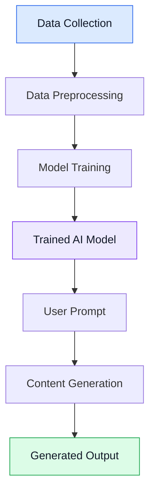
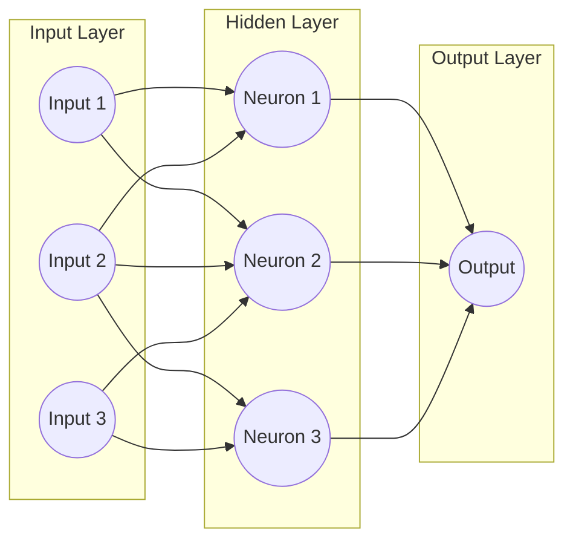
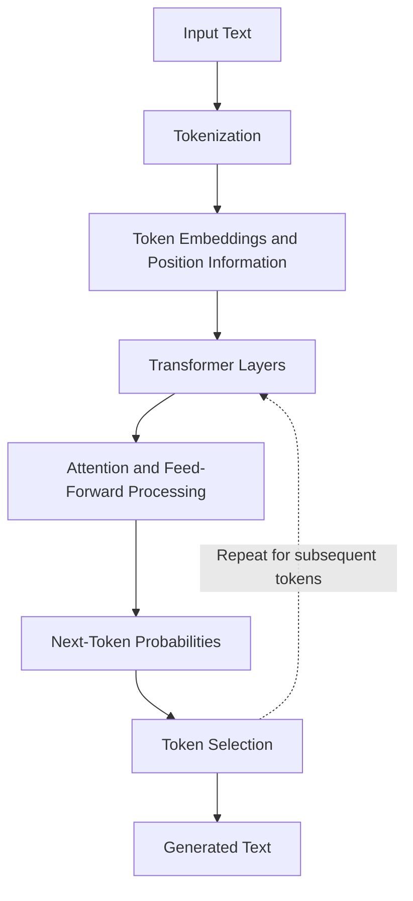
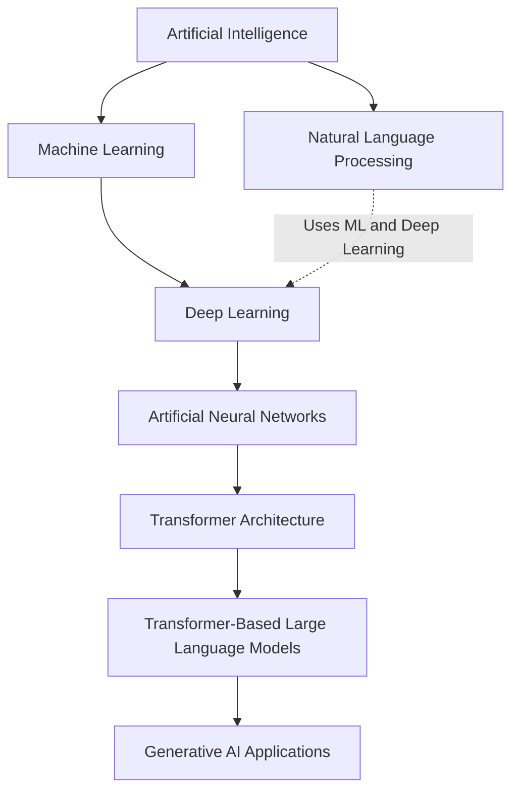
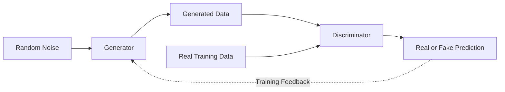
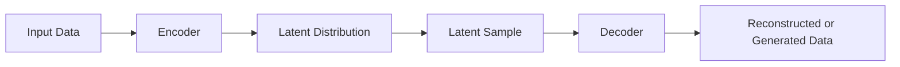
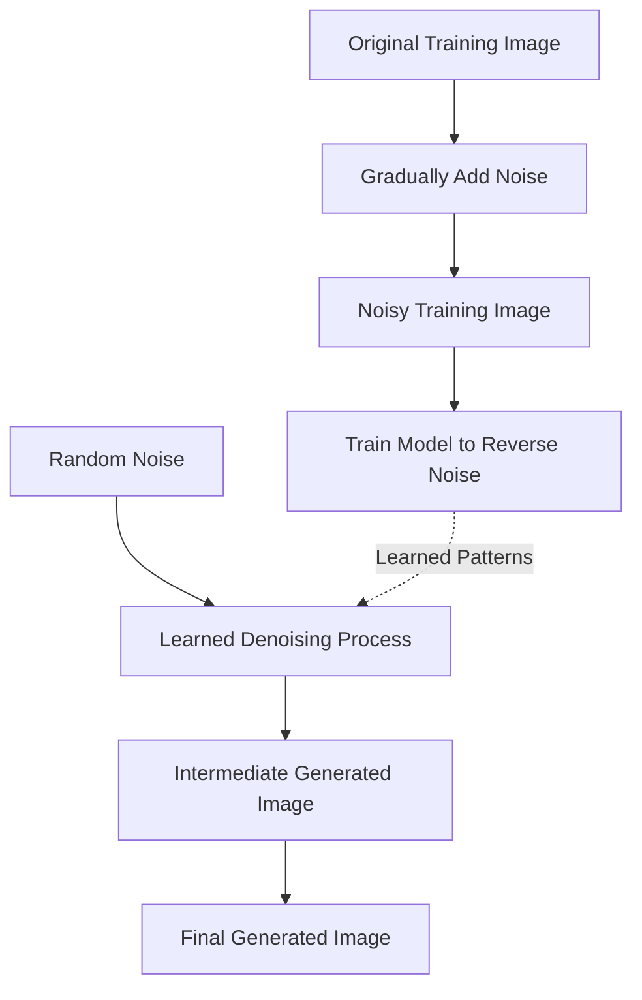
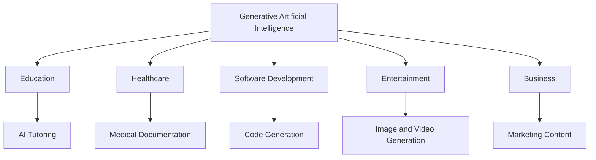

# Aim:	Comprehensive Report on the Fundamentals of Generative AI and Large Language Models (LLMs)
Experiment:
Develop a comprehensive report for the following exercises:
1.	Explain the foundational concepts of Generative AI. 
2.	Focusing on Generative AI architectures. (like transformers).
3.	Generative AI applications.
4.	Generative AI impact of scaling in LLMs.

# Algorithm: Step 1: Define Scope and Objectives
1.1 Identify the goal of the report (e.g., educational, research, tech overview)
1.2 Set the target audience level (e.g., students, professionals)
1.3 Draft a list of core topics to cover
Step 2: Create Report Skeleton/Structure
2.1 Title Page
2.2 Abstract or Executive Summary
2.3 Table of Contents
2.4 Introduction
2.5 Main Body Sections:
•	Introduction to AI and Machine Learning
•	What is Generative AI?
•	Types of Generative AI Models (e.g., GANs, VAEs, Diffusion Models)
•	Introduction to Large Language Models (LLMs)
•	Architecture of LLMs (e.g., Transformer, GPT, BERT)
•	Training Process and Data Requirements
•	Use Cases and Applications (Chatbots, Content Generation, etc.)
•	Limitations and Ethical Considerations
•	Future Trends
2.6 Conclusion
2.7 References
________________________________________
Step 3: Research and Data Collection
3.1 Gather recent academic papers, blog posts, and official docs (e.g., OpenAI, Google AI)
3.2 Extract definitions, explanations, diagrams, and examples
3.3 Cite all sources properly
________________________________________
Step 4: Content Development
4.1 Write each section in clear, simple language
4.2 Include diagrams, figures, and charts where needed
4.3 Highlight important terms and definitions
4.4 Use examples and real-world analogies for better understanding
________________________________________
Step 5: Visual and Technical Enhancement
5.1 Add tables, comparison charts (e.g., GPT-3 vs GPT-4)
5.2 Use tools like Canva, PowerPoint, or LaTeX for formatting
5.3 Add code snippets or pseudocode for LLM working (optional)
________________________________________
Step 6: Review and Edit
6.1 Proofread for grammar, spelling, and clarity
6.2 Ensure logical flow and consistency
6.3 Validate technical accuracy
6.4 Peer-review or use tools like Grammarly or ChatGPT for suggestions
________________________________________
Step 7: Finalize and Export
7.1 Format the report professionally
7.2 Export as PDF or desired format
7.3 Prepare a brief presentation if required (optional)

# Peompts:
```
1)Act as an AI researcher and technical writer. Explain the foundational concepts of Generative AI in a clear, well-structured, and beginner-friendly manner. Include an introduction, definition, working principle, core technologies (Machine Learning, Deep Learning, Neural Networks, Transformers, and Large Language Models), popular Generative AI models, advantages, limitations, and real-world applications. Use Markdown headings, bullet points, and simple language suitable for engineering students. Keep the content concise while covering all essential concepts.
2)Act as a Generative AI expert. Explain the major Generative AI architectures, including Transformers, Generative Adversarial Networks (GANs), Variational Autoencoders (VAEs), and Diffusion Models. Describe how each architecture works, its key components, strengths, limitations, and common applications. Include a comparison table highlighting their primary use cases, advantages, and trade-offs. Format the response in Markdown with clear headings and concise explanations suitable for a technical report.
3)Act as an AI engineer. Explain the overall architecture of Generative AI systems, including the complete workflow from data collection, preprocessing, model training, inference, fine-tuning, and deployment. Describe how different architectures such as Transformers, GANs, VAEs, and Diffusion Models contribute to various applications. Include real-world use cases in healthcare, education, software development, content generation, customer support, marketing, and scientific research. Present the content in Markdown with headings, tables, and bullet points suitable for an academic report.
4)Act as a Large Language Model researcher. Explain the impact of scaling in Large Language Models by discussing model parameters, training datasets, compute resources, scaling laws, and inference-time scaling. Describe how scaling improves accuracy, reasoning, multilingual capabilities, and few-shot learning while also discussing computational cost, energy consumption, bias, hallucinations, and deployment challenges. Include a comparison table of benefits and limitations, and present the explanation in concise Markdown suitable for engineering students.
5)Act as an AI systems engineer. Explain what a Large Language Model (LLM) is and describe the complete pipeline used to build one. Cover data collection, preprocessing and tokenization, Transformer architecture, pre-training, fine-tuning, reinforcement learning from human feedback (RLHF), evaluation, inference, and deployment. Explain each stage briefly, include key components such as embeddings, attention mechanisms, parameters, and tokens, and discuss common applications and challenges. Format the response in Markdown with headings, numbered steps, and bullet points suitable for a GitHub README and technical report.
```


# Output
# 1) CHATGPT RESPONSE:

# Foundational Concepts of Generative Artificial Intelligence

## 1. Introduction

Artificial Intelligence (AI) is a branch of computer science that enables machines to perform tasks requiring human intelligence, such as learning, reasoning, decision-making, and problem-solving.

Traditional AI primarily focuses on analyzing data, identifying patterns, and making predictions. **Generative Artificial Intelligence (Generative AI)** extends these capabilities by producing new content such as text, images, audio, videos, and programming code.

Generative AI is widely used in education, healthcare, software development, entertainment, and business automation.

## 2. Definition of Generative AI

Generative AI refers to a category of artificial intelligence systems that learn patterns and relationships from existing data to generate new content with characteristics similar to the training data.

**Examples:**
- ChatGPT generates explanations, essays, and programming code.
- DALL·E generates images from text descriptions.
- AI music-generation systems produce audio from user instructions.

### Traditional AI vs. Generative AI

| Traditional AI | Generative AI |
|---|---|
| Focuses on prediction and classification | Focuses on creating new content |
| Analyzes existing information | Generates content based on learned patterns |
| Example: Spam email detection | Example: Writing an email |
| Example: Fraud detection | Example: Generating synthetic data |
| Example: Image classification | Example: Image generation |

## 3. Working Principle of Generative AI

Generative AI systems use machine learning algorithms and neural networks to identify patterns in large datasets. After training, the model uses the learned patterns to generate responses based on user inputs.

### Generative AI Workflow



### Steps Involved

1. **Data Collection:** Gather text, images, audio, or other datasets.
2. **Data Preprocessing:** Clean, organize, and prepare the data.
3. **Model Training:** Train neural networks to recognize patterns and relationships.
4. **User Prompt:** Receive an instruction or question from the user.
5. **Content Generation:** Generate new content using learned patterns.
6. **Output:** Present the generated text, image, code, or other content.

**Example:** When a user asks ChatGPT to explain Python programming, the trained model processes the prompt and generates a response based on patterns learned during training.

## 4. Core Technologies Behind Generative AI

### 4.1 Machine Learning (ML)

Machine Learning is a subset of AI that allows computers to identify patterns and learn from data without being explicitly programmed for every task.

**Example:** Predicting house prices using historical property data.

### 4.2 Deep Learning (DL)

Deep Learning is a subset of machine learning that uses artificial neural networks containing multiple processing layers.

These networks learn complex patterns from large datasets.

**Example:** Recognizing objects in images or generating human-like text.

### 4.3 Artificial Neural Networks (ANN)

Artificial Neural Networks are computational systems inspired by biological neural networks.

They contain three major types of layers:

- **Input Layer:** Receives information.
- **Hidden Layers:** Process information and learn relationships.
- **Output Layer:** Produces the final result.

#### Basic Neural Network Architecture



### 4.4 Natural Language Processing (NLP)

Natural Language Processing is a field of AI that enables computers to process, analyze, understand, and generate human language.

**Applications:**
- Chatbots
- Language translation
- Text summarization
- Sentiment analysis
- Question-answering systems

### 4.5 Transformers

Transformers are deep learning architectures that use attention mechanisms to identify important relationships between elements of input data.

The **self-attention mechanism** helps models determine how different words or tokens relate to one another.

**Key Features:**
- Self-attention mechanisms
- Efficient parallel processing during training
- Ability to capture long-range relationships
- Strong performance in language and multimodal applications

#### Simplified Transformer-Based Text Generation



### 4.6 Large Language Models (LLMs)

Large Language Models are AI models trained on extensive text datasets to process and generate natural language.

Many modern LLMs are based on Transformer architectures.

**Examples:**
- GPT
- Claude
- Gemini
- Llama

### Relationship Between Core AI Technologies



*Note: This diagram shows a common technology relationship rather than a strict classification of every AI technique. Generative AI also includes non-Transformer architectures.*

## 5. Popular Generative AI Models and Architectures

### 5.1 Transformers

Transformers generate sequences of data using attention mechanisms.

They are commonly used for text generation, translation, summarization, and code generation.

**Example:** GPT-based language models.

### 5.2 Generative Adversarial Networks (GANs)

GANs contain two neural networks:

- **Generator:** Creates synthetic data.
- **Discriminator:** Attempts to distinguish real data from generated data.

The networks compete during training, helping the generator improve its outputs.

#### GAN Architecture



**Applications:** Synthetic image generation, image enhancement, and data augmentation.

### 5.3 Variational Autoencoders (VAEs)

VAEs are generative neural networks that learn probabilistic representations of input data.

They use an encoder and decoder to represent and reconstruct data.

#### VAE Architecture



**Applications:** Image synthesis, data generation, and anomaly detection research.

### 5.4 Diffusion Models

Diffusion models generate content by learning to reverse a gradual noise-adding process.

During generation, the model progressively removes noise to produce realistic outputs.

#### Diffusion Model Workflow



**Applications:** Text-to-image generation, image editing, and video synthesis.

### Comparison of Generative AI Architectures

| Architecture | Working Principle | Advantages | Limitations | Applications |
|---|---|---|---|---|
| Transformers | Attention-based sequence modeling | Strong language performance | High computing requirements | Chatbots, translation, coding |
| GANs | Generator competes with discriminator | Realistic image generation | Training instability | Synthetic images |
| VAEs | Probabilistic encoding and decoding | Structured latent representations | Can produce blurry images | Image synthesis |
| Diffusion Models | Iterative denoising | High-quality generation | Often computationally expensive | Images, video |

## 6. Popular Generative AI Systems

| AI System | Developer | Main Application |
|---|---|---|
| ChatGPT | OpenAI | Text generation, coding, reasoning |
| Gemini | Google | Text and multimodal generation |
| Claude | Anthropic | Writing, coding, document analysis |
| Llama | Meta | Language applications and research |
| DALL·E | OpenAI | Text-to-image generation |
| Stable Diffusion | Stability AI and open-source ecosystem | Image generation and editing |

## 7. Advantages of Generative AI

1. **Improved Productivity:** Automates repetitive writing, documentation, and content-creation tasks.
2. **Creativity:** Assists with brainstorming, designing, and developing new ideas.
3. **Personalization:** Generates content based on user requirements.
4. **Cost Efficiency:** Can reduce time and resources for selected workflows.
5. **Accessibility:** Supports education, translation, and communication.
6. **Software Development:** Helps generate, explain, test, and debug programming code.

## 8. Limitations of Generative AI

1. **Hallucinations:** AI may produce incorrect or fabricated information.
2. **Bias:** Generated content may reflect biases in training datasets.
3. **Privacy Concerns:** Improper use may expose sensitive information.
4. **Computational Cost:** Training and running advanced models may require significant computing resources.
5. **Copyright Concerns:** Generated content can raise intellectual property questions.
6. **Accuracy Limitations:** Outputs require verification, especially in critical applications.

## 9. Real-World Applications

| Industry | Applications |
|---|---|
| Education | AI tutors, study material generation, personalized learning |
| Healthcare | Clinical documentation assistance, medical image research |
| Software Development | Code generation, debugging, documentation |
| Entertainment | Music, images, video, and game development |
| Marketing | Advertisements, product descriptions, content creation |
| Finance | Financial report drafting, synthetic-data generation |
| Engineering | Design assistance, simulation support, technical documentation |
| Customer Service | Virtual assistants and automated responses |

### Generative AI Application Workflow



## 10. Conclusion

Generative Artificial Intelligence is an important advancement in AI that enables machines to generate text, images, audio, video, and computer code.

It combines machine learning, deep learning, neural networks, and advanced architectures such as Transformers, GANs, VAEs, and diffusion models.

Generative AI offers significant benefits in productivity, creativity, education, and automation. However, responsible use, data protection, and human verification remain essential.

**Key Takeaway:** Traditional AI commonly analyzes data to predict or classify outcomes, whereas Generative AI learns data patterns to create new content.


Key takeaway: Traditional AI mainly analyzes data to predict or classify outcomes, whereas Generative AI learns data patterns to create new content.

 

# Result
